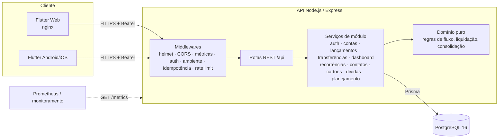
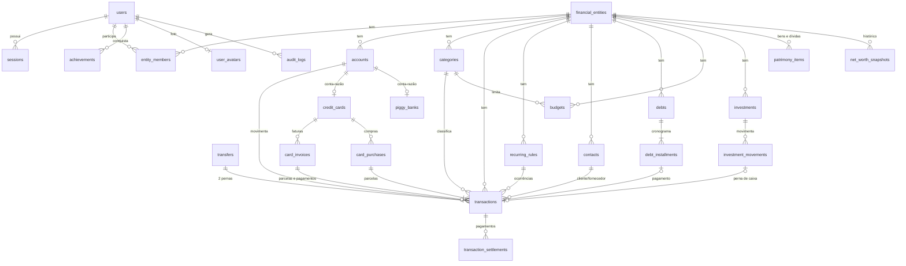

# Arquitetura

## Visão geral

## Componentes

| Camada | Pasta | Responsabilidade |
|---|---|---|
| Front-end | `apps/app/lib/ui` | Telas e widgets fiéis aos protótipos; nenhum cálculo financeiro |
| Estado | `apps/app/lib/state` | Riverpod: sessão, escopo (Pessoal/Pro/Total), mês, consultas |
| Cliente HTTP | `apps/app/lib/core/api_client.dart` | Bearer token, idempotência, tradução de erros |
| Middlewares | `apps/api/src/middleware` | Autenticação, autorização por ambiente (RN11), idempotência, erros |
| Módulos | `apps/api/src/modules/*` | Rotas + serviços por contexto, com transações atômicas e auditoria |
| Domínio | `apps/api/src/domain` | Funções puras e testáveis (RN01–RN03, RN06, RN10, RN13) |
| Contratos | `apps/api/src/contracts` | Schemas Zod e enums compartilhados pelas rotas |
| Persistência | `apps/api/prisma` | Schema, migrations e seed |

## Decisões importantes

- **Dinheiro em centavos inteiros** (`BIGINT` no banco, `int` no app). Nunca ponto flutuante.
- **Saldo derivado:** `saldo = saldo inicial + Σ entradas liquidadas − Σ saídas liquidadas`. Não existe coluna de saldo
  que possa divergir do histórico (RN15). Lançamentos liquidados antes da data de referência da conta são recusados.
- **Previsto × realizado** (RN06): `amount_cents` é o valor do lançamento (faturado); o dinheiro que efetivamente
  entrou/saiu está em `transaction_settlements`, uma linha por pagamento/recebimento com sua data. Saldos, extratos e
  realizado por mês somam essas liquidações — um recebimento parcial em março e outro em abril aparecem cada um no seu
  mês. `settled_amount_cents` é apenas a soma em cache. "Atrasado" é derivado (em aberto com vencimento passado).
- **Recorrências** (RN05): a regra (`recurring_rules`) gera ocorrências que são lançamentos comuns com status Previsto,
  até 90 dias à frente (sempre ao menos a próxima). Um índice único parcial (regra, data) torna a geração idempotente.
  Editar "só esta" marca a ocorrência como *override*; "desta em diante" divide a série em uma nova regra; "toda a
  série" atualiza as previstas sem tocar no que já foi pago. Cancelar uma ocorrência a marca como Cancelada (não é
  recriada). A geração roda na subida da API, a cada 6 h e antes das leituras.
- **Cartões** (RN08): cada cartão tem uma conta-razão (`accounts.type = CREDIT_CARD`, fora das contas de dinheiro).
  Cada parcela de compra é uma despesa liquidada nessa conta, na fatura do seu mês (a 1ª na data da compra, as
  demais no fechamento). Pagar a fatura é uma **transferência** da conta corrente para o cartão: a despesa é
  reconhecida uma única vez e o caixa só diminui no pagamento. O saldo negativo da conta-razão é o limite
  comprometido. Total e valor pago da fatura são derivados dos lançamentos ligados a ela.
- **Dívidas**: o cronograma (PRICE ou SAC, em `domain/debts.ts`) gera uma parcela por mês com principal, juros e
  encargos; cada parcela é uma despesa *pendente* (confirmada) na conta de pagamento, então aparece em contas a
  pagar e na projeção. Multa e mora são a diferença entre o valor pago e o previsto. Amortização extraordinária
  substitui as parcelas a vencer por um novo cronograma; a quitação cobra o saldo devedor + juros pro rata.
- **Planejamento**: a projeção de caixa parte do saldo atual das contas de dinheiro e soma, dia a dia, os
  lançamentos em aberto e as faturas a pagar. *Confirmado* = pendentes, faturas e parcelas de dívida;
  *previsto* = ocorrências de recorrências e estimativas. Orçamentos usam as mesmas liquidações do dashboard (RN13).
- **Cofrinhos**: como os cartões, cada cofrinho tem uma conta-razão (`PIGGY_BANK`) fora do saldo disponível.
  Guardar e resgatar são transferências, então o dinheiro nunca está nos dois lugares. O rendimento *efetivo* é
  lançado como receita ao confirmar o saldo do banco; o *estimado* é calculado na hora pelo índice e nunca gravado
  (RN07). Conquistas da gamificação vêm de marcos e constância, não do número de depósitos.
- **Investimentos**: aportes e resgates geram a perna de caixa `CONTRIBUTION`/`REDEMPTION` (não são receita nem
  despesa). O valor vem do motor do produto (`domain/yields.ts`): renda fixa acumula o indexador dia útil a dia útil
  a partir do último valor informado; ações/ETFs/fundos usam cotas × último preço informado, com aviso de
  desatualizado; produtos manuais usam o último valor informado. Sem índice, não há estimativa.
- **Índices**: CDI/Selic/IPCA vêm do SGS do Banco Central e ficam em `market_rates`. Lançar índice manualmente
  exige `ADMIN_TOKEN`, porque vale para todos os usuários, e nunca sobrescreve o dado oficial.
- **Patrimônio**: ativos − passivos a partir das mesmas fontes (saldos derivados, carteira, dívidas, cartões e bens
  informados). Cada mês encerrado é gravado em `net_worth_snapshots`; o mês corrente é recalculado a cada consulta.
- **Transferências** são duas pernas atômicas ligadas a um registro `transfers` e nunca entram em receitas/despesas
  (RN01). Entre Pessoal e Profissional exigem classificação gerencial (RN09); no Consolidado se anulam (RN10).
- **Consolidado** pondera cada ambiente pela participação do usuário (`ownership_share_bps`), para não presumir que
  todo o caixa da empresa pertence a ele.
- **Uma única regra de classificação de fluxos** (`domain/flows.ts`) é usada pelo dashboard e será usada pelos
  relatórios (RN13).
- **Auditoria** (RN14): toda criação/alteração/exclusão financeira grava `audit_logs` na mesma transação.
  Exclusões são lógicas (`deleted_at`).
- **Idempotência:** `POST` de lançamentos, liquidações e transferências aceitam `Idempotency-Key`; o app sempre envia.
- **Autenticação:** token de sessão opaco (Bearer), guardado só como hash SHA-256, com expiração e revogação.
  Funciona igual em Web, Android e iOS e dispensa proteção CSRF (não há credencial enviada automaticamente).
- **Integridade no banco:** `CHECK` para valores positivos, consistência entre status e valor liquidado,
  e coerência entre tipo `TRANSFER` e `transfer_id`.

## Modelo de dados

Tabelas auxiliares: `password_reset_tokens`, `idempotency_keys`, `audit_logs`, `planning_settings`, `market_rates`.

## Roadmap

| Fase | Escopo |
|---|---|
| 1 — Fundação ✅ | Auth, ambientes, contas, categorias, lançamentos, transferências, dashboard |
| 2 — Gestão financeira ✅ | Recorrências, clientes/fornecedores, contas a pagar/receber, cartões e faturas, dívidas, planejamento |
| 3 — Patrimônio ✅ | Cofrinhos, lista de desejos e gamificação, investimentos com motores por produto, índices do Banco Central, patrimônio com snapshots |
| 4 — Inteligência | Relatórios (PDF/XLSX/CSV), Costelinha IA (backend calcula, IA explica), notificações |
| 5 — Produção | Endurecimento de segurança, testes de desempenho ampliados, publicação mobile |
