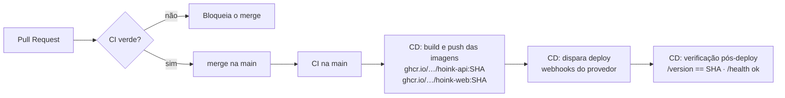

# Entrega contínua e deploy

## Fluxo



1. **Build automatizado das imagens:** o job `publish` constrói `hoink-api` e `hoink-web` e publica no GitHub
   Container Registry (gratuito para repositórios públicos) com duas tags: o commit curto (`a1b2c3d`) e `latest`.
2. **Implantação automatizada:** o job `deploy` chama os webhooks de deploy do provedor de hospedagem
   (`API_DEPLOY_HOOK`, `WEB_DEPLOY_HOOK`). Ele só roda quando a variável do repositório `DEPLOY_ENABLED=true`.
3. **Verificação após o deploy:** o job `verify` consulta `GET {API_PUBLIC_URL}/version` até o `commit`
   publicado ser o mesmo que acabou de ser construído (até 10 min), confere `/health` e o `version.json` do front.
   Se a versão não aparecer, o pipeline falha.
4. **Identificação da versão publicada:** a imagem recebe `APP_VERSION` e `GIT_SHA` no build, expostos em
   `GET /version` (API), `/version.json` (front), no rodapé da tela de Configurações e no label OCI
   `org.opencontainers.image.revision`.

Releases: criar uma tag `vX.Y.Z` (`git tag v0.1.0 && git push --tags`) publica a versão `X.Y.Z`.

## Configuração no GitHub

| Tipo | Nome | Exemplo | Uso |
|---|---|---|---|
| Variável | `DEPLOY_ENABLED` | `true` | Liga os jobs de deploy e verificação |
| Variável | `API_PUBLIC_URL` | `https://hoink-api.exemplo.app` | URL da API (embutida no build do front e usada na verificação) |
| Variável | `WEB_PUBLIC_URL` | `https://hoink.exemplo.app` | URL do front (verificação e link do ambiente) |
| Secret | `API_DEPLOY_HOOK` | URL do webhook | Dispara o redeploy da API |
| Secret | `WEB_DEPLOY_HOOK` | URL do webhook | Dispara o redeploy do front |

Configure em *Settings → Secrets and variables → Actions*. Use o environment `production` para exigir aprovação
manual antes do deploy, se o grupo quiser.

## Variáveis de ambiente da API em produção

| Variável | Obrigatória | Descrição |
|---|---|---|
| `DATABASE_URL` | sim | Conexão PostgreSQL (use o secret do provedor; nunca versionar) |
| `NODE_ENV` | sim | `production` |
| `PORT` | não | Porta HTTP (padrão 3333; muitos provedores injetam a sua) |
| `CORS_ORIGINS` | sim | URL pública do front, ex.: `https://hoink.exemplo.app` |
| `APP_TIMEZONE` | não | Padrão `America/Sao_Paulo` |
| `SESSION_TTL_DAYS` | não | Validade da sessão (padrão 30) |
| `AUTH_RATE_LIMIT` | não | Tentativas de login por IP a cada 15 min (padrão 20) |
| `METRICS_TOKEN` | recomendado | Protege `GET /metrics` com Bearer token |
| `LOG_LEVEL` | não | `info` (padrão) |
| `MARKET_DATA_SYNC` | não | `true` (padrão) busca CDI, Selic e IPCA no Banco Central; `false` desliga |
| `RECEIPT_LOOKUP` | não | `true` (padrão) consulta a NFC-e na Sefaz e a loja na BrasilAPI; `false` usa só o QR Code |
| `ADMIN_TOKEN` | não | Permite lançar índices manualmente (`PUT /api/market-rates`, cabeçalho `X-Admin-Token`) |

As migrations são aplicadas automaticamente na inicialização do contêiner (`prisma migrate deploy`).

## Implantação reproduzível (sem provedor)

Qualquer máquina com Docker reproduz o ambiente publicado:

```bash
export SHA=<commit>          # ou latest
export API_IMAGE=ghcr.io/isadora-correa/hoink-api:$SHA
export WEB_IMAGE=ghcr.io/isadora-correa/hoink-web:$SHA
docker compose --profile full up -d --no-build
curl http://localhost:3333/version   # confere o commit
```

## Hospedagem

O pipeline independe do provedor: qualquer serviço que rode uma imagem Docker e ofereça webhook de deploy
(ou que puxe a tag `latest` do GHCR) funciona. A escolha da hospedagem gratuita será documentada aqui.
